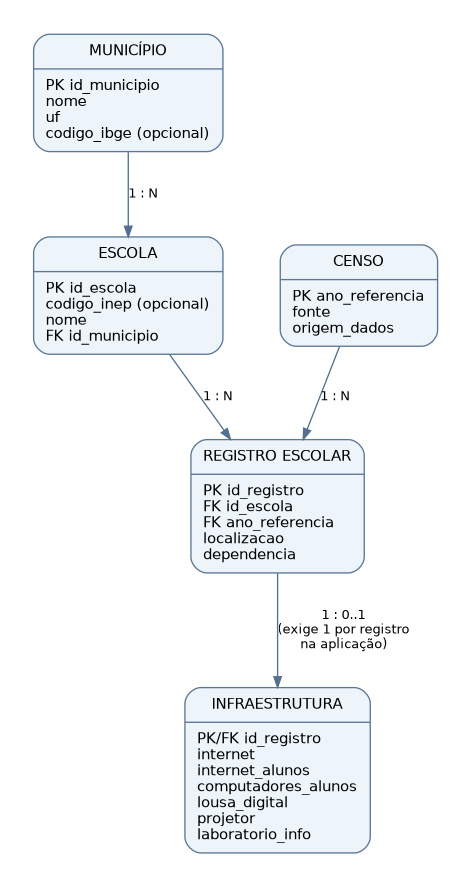

# Fase 02 — Projeto Conceitual e Projeto Lógico

**Instituição:** AESA / CESA — Arcoverde  
**Curso:** Análise e Desenvolvimento de Sistemas  
**Disciplina:** Banco de Dados I — 2ª avaliação  
**Professor:** Esp. Pedro Paz  
**Integrantes:** Kayky Pereira de Araujo e Caique Henrique Da Silva Mendonça  
**Título:** Desigualdade na Infraestrutura Tecnológica das Escolas Brasileiras (EducaData)  
**Fonte utilizada na importação informada pela equipe:** arquivo `Tabela_Escola_2025_V2.csv`, do Censo Escolar 2025 — INEP/MEC.

> **Estado da pesquisa (novembro/2026):** a aplicação mantém uma base de demonstração FICTÍCIA (`educadata.sqlite`) separada do banco importado a partir do CSV do INEP (`educadata_inep2025.sqlite`). Conforme as saídas de console compartilhadas pela equipe, o banco importado reúne 138.085 escolas públicas em funcionamento. Os indicadores de 2025 foram obtidos das consultas ao arquivo local da equipe, mas não foram recalculados independentemente neste pacote. Ainda é necessário conferir o mapeamento com o dicionário oficial da edição baixada.

## 1. Objetivo

Modelar as informações sobre localização, dependência administrativa e recursos tecnológicos das escolas para permitir consultas e comparações ao longo dos anos.

**Pergunta central:** Como a localização urbana/rural e a dependência administrativa se relacionam à presença de internet e equipamentos tecnológicos nas escolas?

## 2. Etapa 3 — Modelo conceitual

### Entidades

1. **Município:** localiza geograficamente escolas; atributos: identificador, nome, UF e código IBGE quando disponível.
2. **Escola:** representa a instituição; atributos: identificador interno, código INEP quando publicado, nome quando disponível e município.
3. **Censo:** identifica o ano de referência, fonte e natureza dos dados.
4. **Registro Escolar:** guarda as características de uma escola em uma edição do Censo, como localização e dependência administrativa.
5. **Infraestrutura:** reúne os recursos de uma escola naquele ano, evitando misturar anos diferentes.

### Diagrama Entidade-Relacionamento (DER)



Versões editáveis: `DER_mermaid.mmd` e `DER_graphviz.dot`.

### Cardinalidades

| Origem | Destino | Cardinalidade | Explicação |
|---|---|---|---|
| Município | Escola | 1:N | Um município pode reunir muitas escolas; cada escola pertence a um município neste recorte. |
| Escola | Registro Escolar | 1:N | Uma escola pode ter registros de vários anos. |
| Censo | Registro Escolar | 1:N | Cada ano agrega registros de várias escolas. |
| Registro Escolar | Infraestrutura | 1:1 conceitual | Cada registro importado deve ter uma ficha de infraestrutura. No esquema SQL o relacionamento é 1:0..1 até a ficha ser inserida; a aplicação grava os dois na mesma transação. |

### Regras de negócio

- Não pode haver dois registros da mesma escola no mesmo ano.
- Todo registro escolar deve apontar para uma escola e um Censo existentes.
- Informações de localização e dependência administrativa são registradas por ano, pois podem mudar.
- O registro de infraestrutura tem a mesma chave primária de `registro_escolar`, que também funciona como chave estrangeira.
- `internet=1` significa **Sim**, `internet=0` significa **Não** e `NULL` significa **desconhecido / não informado**; nunca converter ausências em `0`.
- `codigo_inep` é opcional até confirmação de disponibilidade no conjunto público efetivamente utilizado.
- O tipo de dado (`FICTICIOS` ou `OFICIAIS`) deve ser explicitado no cadastro de Censo, evitando atribuição falsa ao INEP.

## 3. Etapa 4 — Projeto lógico

### Modelo relacional

```text
MUNICIPIO(id_municipio PK, nome, uf, codigo_ibge UNIQUE NULL)
ESCOLA(id_escola PK, codigo_inep UNIQUE NULL, nome, id_municipio FK)
CENSO(ano_referencia PK, fonte, origem_dados)
REGISTRO_ESCOLAR(id_registro PK, id_escola FK, ano_referencia FK,
                 localizacao, dependencia, UNIQUE(id_escola, ano_referencia))
INFRAESTRUTURA(id_registro PK/FK, internet, internet_alunos,
               computadores_alunos, lousa_digital, projetor, laboratorio_info)
```

### Dicionário de dados lógico

| Tabela | Campo | Tipo SQL | Regra / descrição |
|---|---|---|---|
| municipio | id_municipio | INTEGER | PK; identifica município. |
| municipio | nome | TEXT | Obrigatório. |
| municipio | uf | TEXT | Sigla de duas letras. |
| municipio | codigo_ibge | TEXT | Opcional; único quando preenchido. |
| escola | id_escola | INTEGER | PK interna. |
| escola | codigo_inep | TEXT | Único se disponível; caso contrário NULL. |
| escola | nome | TEXT | Obrigatório no protótipo; depende da disponibilidade real. |
| escola | id_municipio | INTEGER | FK para municipio. |
| censo | ano_referencia | INTEGER | PK, entre 1990 e 2100. |
| censo | fonte | TEXT | Origem descrita em texto. |
| censo | origem_dados | TEXT | FICTICIOS ou OFICIAIS. |
| registro_escolar | id_registro | INTEGER | PK. |
| registro_escolar | id_escola | INTEGER | FK para escola. |
| registro_escolar | ano_referencia | INTEGER | FK para censo. |
| registro_escolar | localizacao | TEXT | Urbana ou Rural. |
| registro_escolar | dependencia | TEXT | Municipal, Estadual, Federal ou Privada. |
| infraestrutura | id_registro | INTEGER | PK e FK; um registro suporta até uma ficha. |
| infraestrutura | internet | INTEGER | 1 sim, 0 não, NULL desconhecido. |
| infraestrutura | internet_alunos | INTEGER | 1 sim, 0 não, NULL desconhecido. |
| infraestrutura | computadores_alunos | INTEGER | Valor ≥ 0, NULL desconhecido. |
| infraestrutura | lousa_digital | INTEGER | 1/0/NULL. |
| infraestrutura | projetor | INTEGER | 1/0/NULL. |
| infraestrutura | laboratorio_info | INTEGER | 1/0/NULL. |

### SQL

- `sql/01_estrutura.sql`: `CREATE TABLE`, chaves, `CHECK`, índices e relacionamentos.
- `sql/02_dados_FICTICIOS.sql`: registros exclusivamente demonstrativos.
- `sql/03_consultas.sql`: consultas `SELECT` com `JOIN`, `GROUP BY`, agregações e percentuais.

### Perguntas de pesquisa e consultas

1. Como varia o percentual de escolas com internet entre áreas urbanas e rurais?
2. Em quais municípios há maior proporção de respostas que indicam ausência de internet?
3. Qual é a disponibilidade de internet para estudantes por dependência administrativa?
4. Quais escolas possuem lousa digital, projetor ou laboratório de informática?
5. O cenário mudou de uma edição do Censo para outra?

**Método de cálculo:** para percentuais, usar como denominador somente as escolas que informaram `Sim` ou `Não`. Informações ausentes ficam fora do denominador e devem ser reportadas como ausência de resposta.

## 4. Decisões técnicas

- **Linguagem:** Java 17.
- **IDE:** IntelliJ IDEA.
- **Banco de dados:** SQLite (arquivo local; sem instalar servidor).
- **Acesso:** JDBC com `org.xerial:sqlite-jdbc` via Maven.
- **Integridade:** PK, FK, restrições `UNIQUE`, `CHECK` e transações para o cadastro.
- **Justificativa:** esta configuração permite demonstração simples em computadores de laboratório e separa o programa das consultas SQL.

## 5. Limitações e validações pendentes

- O CSV do Censo Escolar 2025 já foi baixado e importado pela equipe, conforme console; **o dicionário da edição efetivamente usada ainda precisa ser conferido coluna por coluna**.
- Conferir a disponibilidade e a definição exata de todas as variáveis e identificadores na edição pública baixada.
- Concluir a validação dos nomes/códigos oficiais contra o dicionário da edição V2 que a equipe baixou.
- Confirmar que a granularidade da tabela pública de escolas é adequada ao recorte e aos campos analisados.
- Os percentuais já foram calculados pelo aplicativo sobre o banco importado; registrar evidências reprodutíveis, verificar filtros e informar ausências de resposta.
- Os nomes dos integrantes foram registrados; preencher a contribuição efetiva de cada um e validar o modelo com o professor.

**Aviso sobre IA:** Documentos e código preparados com auxílio de IA. Antes da entrega, a equipe deverá revisar, comentar e registrar corretamente a utilização conforme as orientações da disciplina. Os números citados são resultados do console, não de uma auditoria independente do microdado.

## 6. Fonte e continuidade

- INEP/MEC — Microdados do Censo Escolar: https://www.gov.br/inep/pt-br/acesso-a-informacao/dados-abertos/microdados/censo-escolar
- Próxima atividade: conferir a planilha de dicionário da edição V2, documentar a divisão real de responsabilidades e publicar o repositório.
